<!-- city:start -->

<!-- city:end -->

## What I'm building

Most of my open-source work goes to the [Odoo Community Association](https://github.com/OCA):

<!-- repos:start -->
Also merged into [l10n-spain](https://github.com/OCA/l10n-spain/pulls?q=is%3Apr+author%3Aoliverg09) · [partner-contact](https://github.com/OCA/partner-contact/pulls?q=is%3Apr+author%3Aoliverg09) · [account-invoicing](https://github.com/OCA/account-invoicing/pulls?q=is%3Apr+author%3Aoliverg09) · [field-service](https://github.com/OCA/field-service/pulls?q=is%3Apr+author%3Aoliverg09) · [purchase-workflow](https://github.com/OCA/purchase-workflow/pulls?q=is%3Apr+author%3Aoliverg09) · [sale-workflow](https://github.com/OCA/sale-workflow/pulls?q=is%3Apr+author%3Aoliverg09) · [account-invoice-reporting](https://github.com/OCA/account-invoice-reporting/pulls?q=is%3Apr+author%3Aoliverg09) · [product-attribute](https://github.com/OCA/product-attribute/pulls?q=is%3Apr+author%3Aoliverg09) · [repo-maintainer-conf](https://github.com/OCA/repo-maintainer-conf/pulls?q=is%3Apr+author%3Aoliverg09) · [reporting-engine](https://github.com/OCA/reporting-engine/pulls?q=is%3Apr+author%3Aoliverg09) · [server-tools](https://github.com/OCA/server-tools/pulls?q=is%3Apr+author%3Aoliverg09) · [stock-logistics-reporting](https://github.com/OCA/stock-logistics-reporting/pulls?q=is%3Apr+author%3Aoliverg09) · [stock-logistics-warehouse](https://github.com/OCA/stock-logistics-warehouse/pulls?q=is%3Apr+author%3Aoliverg09)
<!-- repos:end -->

## About me

I'm an Odoo developer at [@BinhexTeam](https://github.com/BinhexTeam), where I build custom modules, connectors and integrations, and send the reusable parts upstream to the OCA. I enjoy the plumbing between systems: APIs, webhooks and message gateways, and making them hold up when everything happens at once. I trained as a multiplatform application developer (DAM); my final project was [NurseCare](https://github.com/oliverg09/Patient-Nurse-Call-System), a patient–nurse call system built with FastAPI.

**Odoo** &nbsp;15 → 19 · OCA · ORM · OWL · QWeb · Connector · queue_job · Migrations & backports · Mail gateways · eCommerce · POS  
**Languages** &nbsp;Python · JavaScript · SQL · HTML · CSS  
**Tools** &nbsp;PostgreSQL · MySQL · Docker · Linux · Git · GitHub Actions · pre-commit · FastAPI · REST & GraphQL APIs

## Latest pull requests

<!-- pulls:start -->
- 🟢 [**mail_message_import_whatsapp**: WhatsApp channel for the inbox](https://github.com/OCA/social/pull/1963) OCA/social · ADD · [17.0](https://github.com/OCA/social/pull/1963) · [18.0](https://github.com/OCA/social/pull/1962) · Nov 3
- 🟢 [**mail_message_import_email**: email channel for the inbox](https://github.com/OCA/social/pull/1961) OCA/social · ADD · [17.0](https://github.com/OCA/social/pull/1961) · [18.0](https://github.com/OCA/social/pull/1960) · Nov 3
- 🟢 [**mail_message_import**: one inbox for the messages received on any channel](https://github.com/OCA/social/pull/1959) OCA/social · ADD · [17.0](https://github.com/OCA/social/pull/1959) · [18.0](https://github.com/OCA/social/pull/1952) · Nov 3
- 🟢 [**mail_gateway**: cache gateway map by state and type](https://github.com/OCA/social/pull/1951) OCA/social · FIX · [17.0](https://github.com/OCA/social/pull/1951) · [18.0](https://github.com/OCA/social/pull/1950) · Oct 30
- 🟣 [**shopify_connector**: Backport updates from 19.0](https://github.com/OCA/connector-shopify/pull/29) OCA/connector-shopify · BKP · 18.0 · Oct 27
- 🟣 [**shopify_connector_website_sale**: Migration to 18.0](https://github.com/OCA/connector-shopify/pull/28) OCA/connector-shopify · MIG · 18.0 · Oct 27

🟣 merged · 🟢 open · ⚪ closed
<!-- pulls:end -->

[All my pull requests →](https://github.com/search?q=author%3Aoliverg09+is%3Apr&type=pullrequests)

The header, the city, the cards and these lists are redrawn every day by a GitHub Action (see <code>tools/profile</code>).
