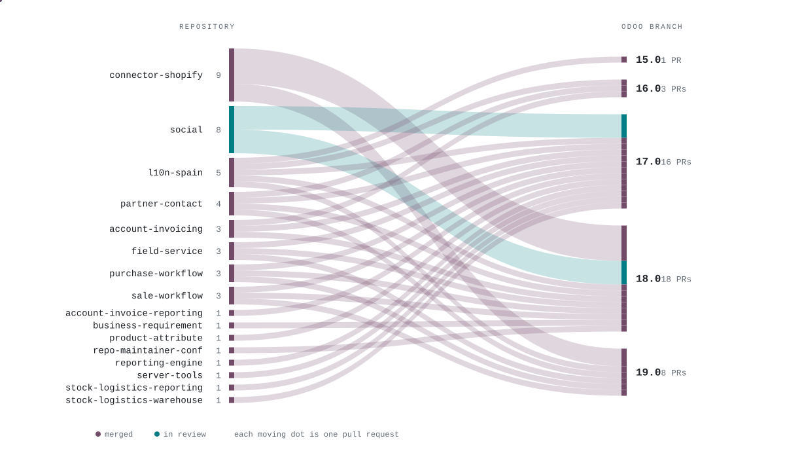

<picture>
  <source media="(prefers-color-scheme: dark)" srcset="img/header-dark.svg">
  
</picture>

I build Odoo modules at [Binhex](https://github.com/BinhexTeam) and send the reusable ones upstream to the [OCA](https://github.com/OCA). Mostly the parts where Odoo has to talk to something else: online stores, chat apps, mailboxes, webhooks. If I were an Odoo module, this would be my manifest:

```python
# oliverg09/__manifest__.py
{
    "name": "Oliver García",
    "summary": "Connects Odoo to the rest of the world",
    "version": "19.0.1.0.0",
    "author": "Binhex, Odoo Community Association (OCA)",
    "website": "https://github.com/oliverg09",
    "location": "Spain",
    "depends": ["python", "javascript", "postgresql", "owl", "connector", "queue_job"],
    "data": ["shopify.xml", "whatsapp.xml", "email.xml"],
    "external_dependencies": {"bin": ["coffee"]},
    "development_status": "Production/Stable",
    "maintainers": ["oliverg09"],
    "license": "AGPL-3",
}
```

## 🔌 Plugged into Odoo

<table>
<tr>
<td width="33%" valign="top">

**🛒 Shopify ⇄ Odoo**<br>
<sub>[OCA/connector-shopify](https://github.com/OCA/connector-shopify)</sub>

Took the connector and its accounting, POS and eCommerce modules to Odoo 18, added Dev Dashboard sign-in, and made token renewal safe when two workers race for it.

</td>
<td width="33%" valign="top">

**💬 Any inbox → Odoo**<br>
<sub>[OCA/social](https://github.com/OCA/social)</sub>

`mail_message_import`: one inbox for whatever a company receives, whatever the channel. Email and WhatsApp plug into it as their own modules.

</td>
<td width="33%" valign="top">

**📋 Requirements → Projects**<br>
<sub>[OCA/business-requirement](https://github.com/OCA/business-requirement)</sub>

When a business requirement is approved, its deliverables turn into project tasks, with the time already allocated.

</td>
</tr>
</table>

## 🌊 Where my pull requests go

<picture>
  <source media="(prefers-color-scheme: dark)" srcset="img/flow-dark.svg">
  
</picture>

## ⏳ Waiting for review

| Change | Odoo | Repository | Opened |
|:--|:--|:--|:--|
| `ADD` [**mail\_message\_import\_whatsapp**](https://github.com/OCA/social/pull/1963) · receive WhatsApp messages into the shared inbox | [17.0](https://github.com/OCA/social/pull/1963) · [18.0](https://github.com/OCA/social/pull/1962) | [social](https://github.com/OCA/social) | Nov 3 |
| `ADD` [**mail\_message\_import\_email**](https://github.com/OCA/social/pull/1961) · receive email into the shared inbox | [17.0](https://github.com/OCA/social/pull/1961) · [18.0](https://github.com/OCA/social/pull/1960) | [social](https://github.com/OCA/social) | Nov 3 |
| `ADD` [**mail\_message\_import**](https://github.com/OCA/social/pull/1959) · one shared inbox for messages from any channel | [17.0](https://github.com/OCA/social/pull/1959) · [18.0](https://github.com/OCA/social/pull/1952) | [social](https://github.com/OCA/social) | Nov 3 |
| `FIX` [**mail\_gateway**](https://github.com/OCA/social/pull/1951) · cache gateway map by state and type | [17.0](https://github.com/OCA/social/pull/1951) · [18.0](https://github.com/OCA/social/pull/1950) | [social](https://github.com/OCA/social) | Oct 30 |

## ✅ Recently merged

| Change | Odoo | Repository | Merged |
|:--|:--|:--|:--|
| `MIG` [**shopify\_connector\_website\_sale**](https://github.com/OCA/connector-shopify/pull/28) · Migration to 18.0 | [18.0](https://github.com/OCA/connector-shopify/pull/28) | [connector-shopify](https://github.com/OCA/connector-shopify) | Oct 30 |
| `BKP` [**shopify\_connector**](https://github.com/OCA/connector-shopify/pull/29) · Backport updates from 19.0 | [18.0](https://github.com/OCA/connector-shopify/pull/29) | [connector-shopify](https://github.com/OCA/connector-shopify) | Oct 27 |
| `FIX` [**attachment\_logging**](https://github.com/OCA/server-tools/pull/3778) · correct mail name | [17.0](https://github.com/OCA/server-tools/pull/3778) | [server-tools](https://github.com/OCA/server-tools) | Oct 27 |
| `ADD` [**business\_requirement\_deliverable\_project**](https://github.com/OCA/business-requirement/pull/409) · approved deliverables become project tasks | [18.0](https://github.com/OCA/business-requirement/pull/409) | [business-requirement](https://github.com/OCA/business-requirement) | Oct 21 |
| `FIX` [**shopify\_connector**](https://github.com/OCA/connector-shopify/pull/12) · serialise token renewal with an advisory lock | [19.0](https://github.com/OCA/connector-shopify/pull/12) | [connector-shopify](https://github.com/OCA/connector-shopify) | Sep 11 |

<sub>Before Odoo: [NurseCare](https://github.com/oliverg09/Patient-Nurse-Call-System), a patient–nurse call system in FastAPI, my final project for the DAM degree.</sub><br>
<sub>Synced on 3 Nov 2026. A GitHub Action redraws this page every morning with plain Python ([`profile/`](profile)).</sub>
