**Hi, I'm Oliver** 👋 Odoo developer at [Binhex](https://github.com/BinhexTeam) and contributor to the [OCA](https://github.com/OCA).

This is my GitHub, kept as an aquarium. Every day I contribute, a fish joins the tank: days of the same month swim in the same school, and busier days make bigger fish. Every pull request brings a creature whose species depends on the change, and every repository I work on grows its own coral. As the numbers grow, new things unlock: a kelp forest, a shipwreck, a treasure chest…

## 🐠 New arrivals

| | Change | Odoo | Repository | Merged |
|:-:|:--|:--|:--|:--|
| 🦀 | `FIX` [**mail\_gateway**](https://github.com/OCA/social/pull/1950) · cache gateway map by state and type | [18.0](https://github.com/OCA/social/pull/1950) | [social](https://github.com/OCA/social) | Nov 3 |
| 🐢 | `MIG` [**shopify\_connector\_website\_sale**](https://github.com/OCA/connector-shopify/pull/28) · Migration to 18.0 | [18.0](https://github.com/OCA/connector-shopify/pull/28) | [connector-shopify](https://github.com/OCA/connector-shopify) | Oct 30 |
| 🐚 | `BKP` [**shopify\_connector**](https://github.com/OCA/connector-shopify/pull/29) · Backport updates from 19.0 | [18.0](https://github.com/OCA/connector-shopify/pull/29) | [connector-shopify](https://github.com/OCA/connector-shopify) | Oct 27 |
| 🦀 | `FIX` [**attachment\_logging**](https://github.com/OCA/server-tools/pull/3778) · correct mail name | [17.0](https://github.com/OCA/server-tools/pull/3778) | [server-tools](https://github.com/OCA/server-tools) | Oct 27 |
| 🐡 | `ADD` [**business\_requirement\_deliverable\_project**](https://github.com/OCA/business-requirement/pull/409) · approved deliverables become project tasks | [18.0](https://github.com/OCA/business-requirement/pull/409) | [business-requirement](https://github.com/OCA/business-requirement) | Oct 21 |
| 🦀 | `FIX` [**shopify\_connector**](https://github.com/OCA/connector-shopify/pull/12) · serialise token renewal with an advisory lock | [19.0](https://github.com/OCA/connector-shopify/pull/12) | [connector-shopify](https://github.com/OCA/connector-shopify) | Sep 11 |

## 🪼 In quarantine

Pull requests waiting for review. They drift around as jellyfish until they're merged.

| | Change | Odoo | Repository | Opened |
|:-:|:--|:--|:--|:--|
| 🪼 | `ADD` [**mail\_message\_import**](https://github.com/OCA/social/pull/1965) · one shared inbox for messages from any channel | [17.0](https://github.com/OCA/social/pull/1965) · [18.0](https://github.com/OCA/social/pull/1966) | [social](https://github.com/OCA/social) | Nov 4 |
| 🪼 | `ADD` [ai\_message\_import, ai\_message\_import\_purchase, ai\_message\_import\_sale](https://github.com/OCA/ai/pull/153) | [17.0](https://github.com/OCA/ai/pull/153) · [18.0](https://github.com/OCA/ai/pull/150) | [ai](https://github.com/OCA/ai) | Nov 4 |
| 🪼 | `MIG` [**ai\_connection\_openai**](https://github.com/OCA/ai/pull/152) · Migration to 17.0 | [17.0](https://github.com/OCA/ai/pull/152) | [ai](https://github.com/OCA/ai) | Nov 4 |
| 🪼 | `MIG` [**ai\_connection**](https://github.com/OCA/ai/pull/151) · Migration to 17.0 | [17.0](https://github.com/OCA/ai/pull/151) | [ai](https://github.com/OCA/ai) | Nov 4 |
| 🪼 | `ADD` [**mail\_message\_import\_whatsapp**](https://github.com/OCA/social/pull/1963) · receive WhatsApp messages into the shared inbox | [17.0](https://github.com/OCA/social/pull/1963) · [18.0](https://github.com/OCA/social/pull/1962) | [social](https://github.com/OCA/social) | Nov 3 |
| 🪼 | `ADD` [**mail\_message\_import\_email**](https://github.com/OCA/social/pull/1961) · receive email into the shared inbox | [17.0](https://github.com/OCA/social/pull/1961) · [18.0](https://github.com/OCA/social/pull/1960) | [social](https://github.com/OCA/social) | Nov 3 |

## 🪸 The reef

[connector-shopify](https://github.com/OCA/connector-shopify/pulls?q=is%3Apr+author%3Aoliverg09) 9 · [social](https://github.com/OCA/social/pulls?q=is%3Apr+author%3Aoliverg09) 8 · [l10n-spain](https://github.com/OCA/l10n-spain/pulls?q=is%3Apr+author%3Aoliverg09) 5 · [ai](https://github.com/OCA/ai/pulls?q=is%3Apr+author%3Aoliverg09) 4 · [partner-contact](https://github.com/OCA/partner-contact/pulls?q=is%3Apr+author%3Aoliverg09) 4 · [account-invoicing](https://github.com/OCA/account-invoicing/pulls?q=is%3Apr+author%3Aoliverg09) 3 · [field-service](https://github.com/OCA/field-service/pulls?q=is%3Apr+author%3Aoliverg09) 3 · [purchase-workflow](https://github.com/OCA/purchase-workflow/pulls?q=is%3Apr+author%3Aoliverg09) 3 · [sale-workflow](https://github.com/OCA/sale-workflow/pulls?q=is%3Apr+author%3Aoliverg09) 3 · [account-invoice-reporting](https://github.com/OCA/account-invoice-reporting/pulls?q=is%3Apr+author%3Aoliverg09) 1 · [business-requirement](https://github.com/OCA/business-requirement/pulls?q=is%3Apr+author%3Aoliverg09) 1 · [product-attribute](https://github.com/OCA/product-attribute/pulls?q=is%3Apr+author%3Aoliverg09) 1 · [repo-maintainer-conf](https://github.com/OCA/repo-maintainer-conf/pulls?q=is%3Apr+author%3Aoliverg09) 1 · [reporting-engine](https://github.com/OCA/reporting-engine/pulls?q=is%3Apr+author%3Aoliverg09) 1 · [server-tools](https://github.com/OCA/server-tools/pulls?q=is%3Apr+author%3Aoliverg09) 1 · [stock-logistics-reporting](https://github.com/OCA/stock-logistics-reporting/pulls?q=is%3Apr+author%3Aoliverg09) 1 · [stock-logistics-warehouse](https://github.com/OCA/stock-logistics-warehouse/pulls?q=is%3Apr+author%3Aoliverg09) 1

Fed on 4 Nov 2026 by a GitHub Action running plain Python ([`profile/`](profile)). Next in the tank: a shipwreck at 50 merged PRs (39 so far).
